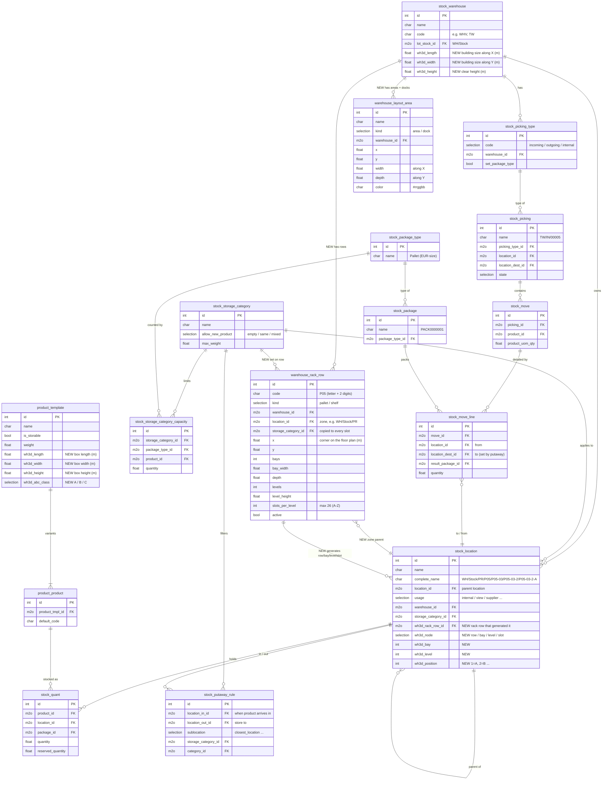
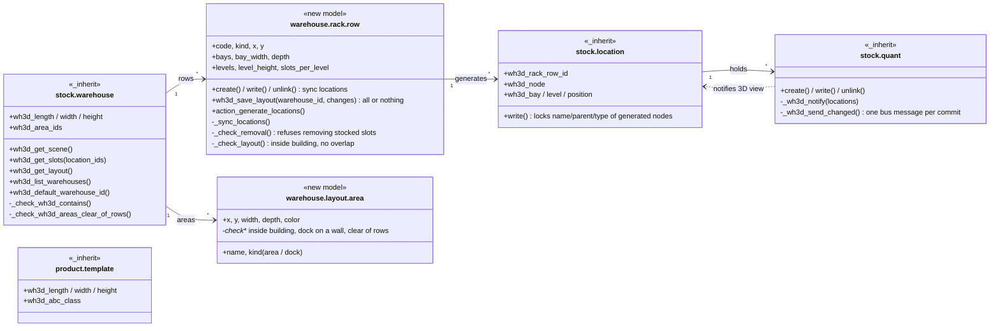
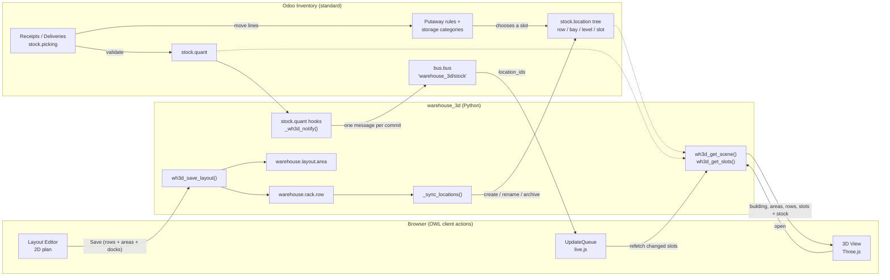

# Warehouse 3D: data schema and how it extends Odoo Inventory

Three diagrams:

1. **ER diagram**: the Odoo Inventory (`stock`) tables we touch, plus our two new tables.
2. **Class diagram**: which Odoo models we extend (`_inherit`) and which we add (`_name`).
3. **Flow diagram**: how data moves between the editor, the models, Inventory and the 3D view.

Model names use `_` instead of `.` because Mermaid entity names cannot contain dots
(`stock_location` = `stock.location`). Fields starting with `wh3d_` are added by this module.

---

## 1. ER diagram: Odoo Inventory + our additions

**Reading it:** Odoo already models a warehouse as a tree of `stock.location` records holding
`stock.quant`s. We did not replace any of that. A `warehouse.rack.row` is a *generator*: from its
shape (bays × levels × slots) it creates the location tree under its zone and tags each node with
`wh3d_*` fields so the 3D view knows where it sits. `warehouse.layout.area` is drawing-only (no stock).

---

## 2. Class diagram: extended vs new models

`<<_inherit>>` = an existing Odoo model we add fields/methods to. `<<new model>>` = a table this
module creates.

---

## 3. Flow: editor → Inventory → 3D view

**In one sentence:** we keep Odoo's own locations, quants, putaway and transfers untouched. We add
a layout layer (rack rows, areas, building size) that *generates* those locations, and a
read/notify layer (scene RPC + bus message) that draws them in 3D and updates them live.
